# Desktop College Dorms

An offline-first desktop and Android app for creating AI characters and chatting with them: one-on-one, in group
chats, or in Discord-style channels where the characters talk to each other too.

Everything lives on your device. A local model engine (llama.cpp) is **built in**, so there is nothing else to install.
Cloud APIs are optional and use your own key.

> The "dorm" theme is a skin: dorms are spaces with their own channels, like servers in Discord.

## Screenshots

Rendered from the real app with original demo characters. (Cards, chats and avatars here are made up for the screenshots.)

**Desktop**

| | |
|---|---|
| 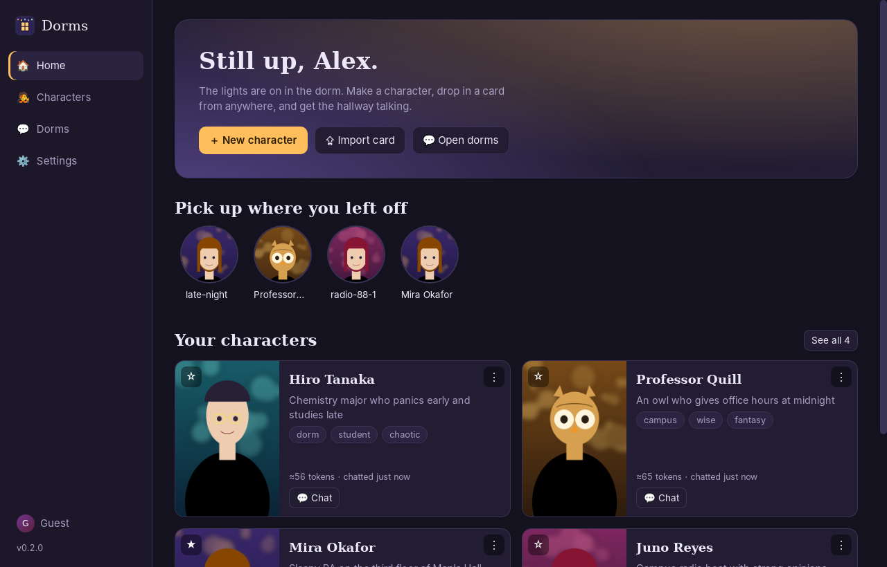<br>**Home**: jump back into chats, your characters at a glance | 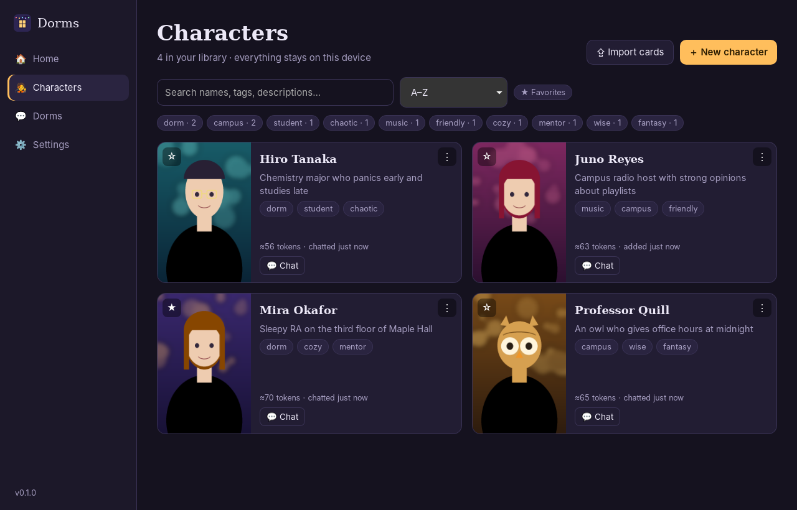<br>**Library**: search, tags, favorites, import cards |
| 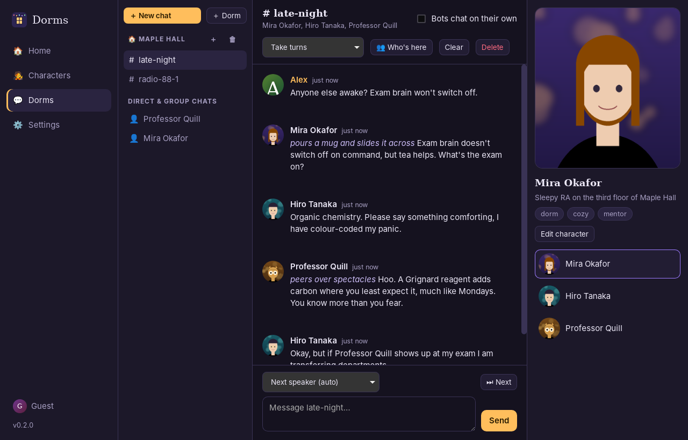<br>**Dorm channels**: characters talk to you and to each other | 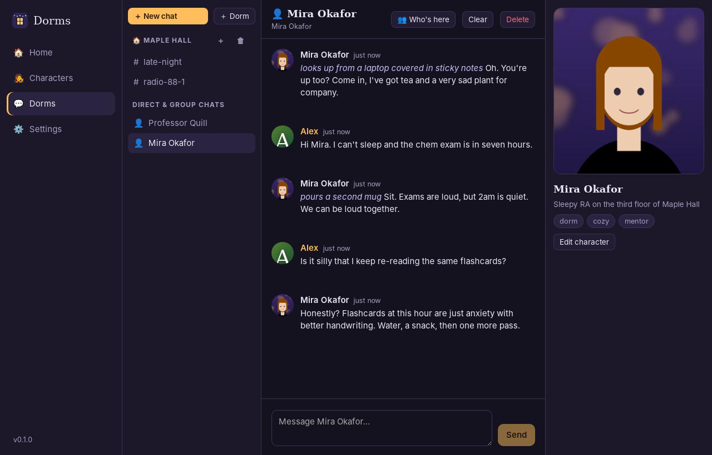<br>**Chat**: swipe, regenerate, continue, edit; image, GIF, video or live 3D VRM beside it |
| 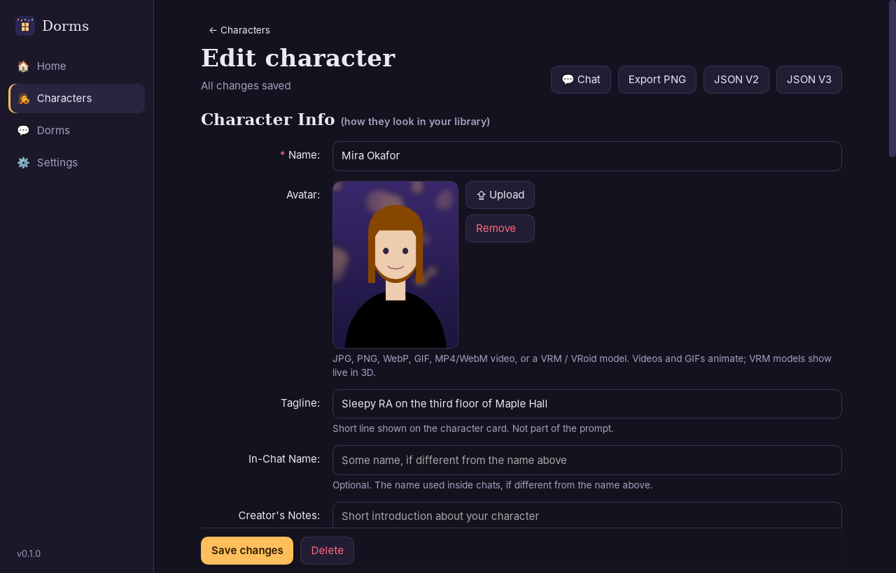<br>**Character editor**: Chub-style, with live token counts | 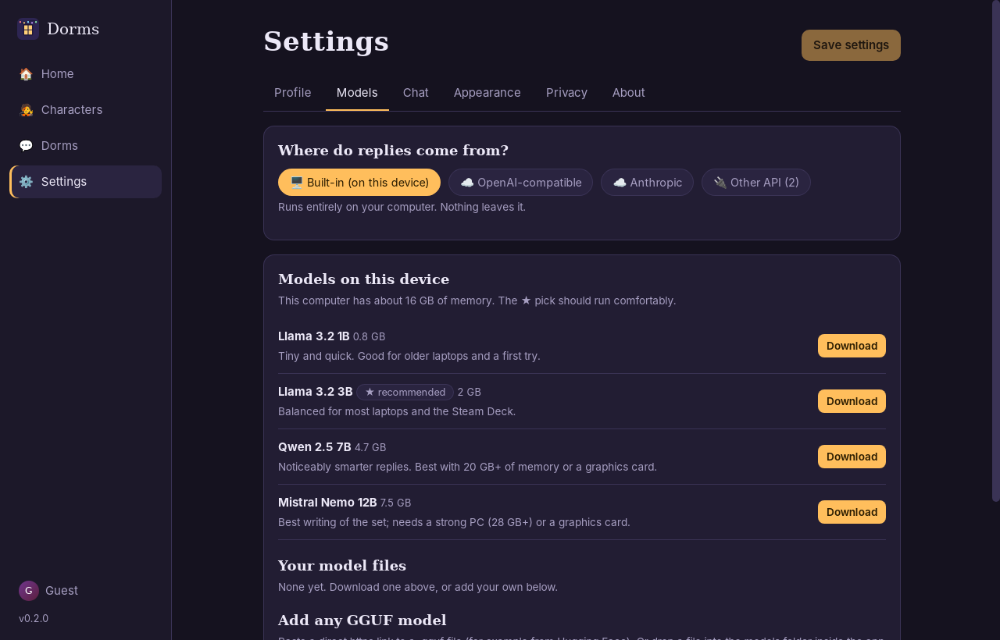<br>**Built-in models**: sized to your computer, resumable downloads |
| 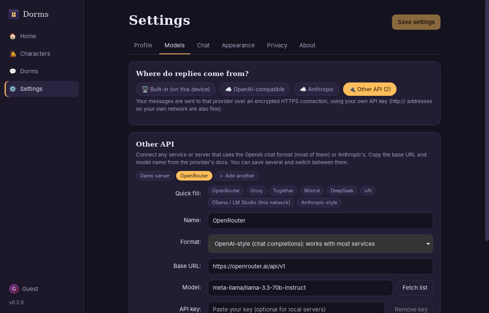<br>**Other API**: plug in any OpenAI- or Anthropic-style service | 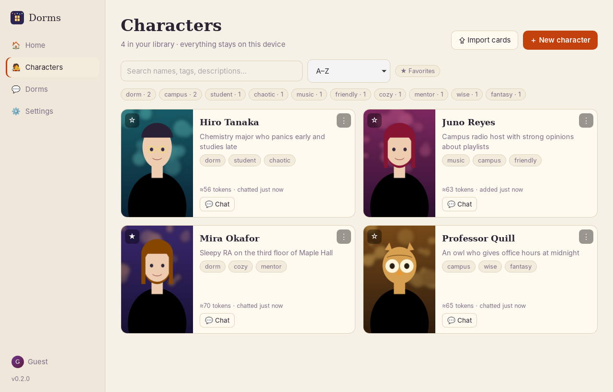<br>**Themes**: dusk, midnight and a light "paper" theme |
| 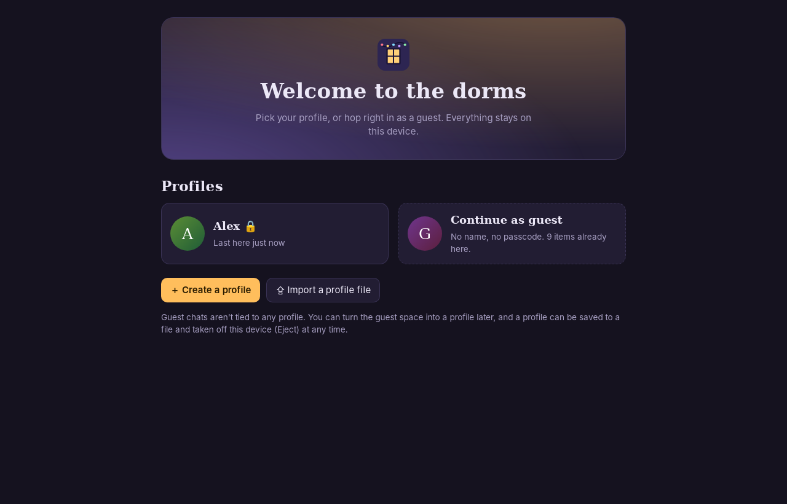<br>**Profiles**: local accounts with an optional passcode, or hop in as a guest | 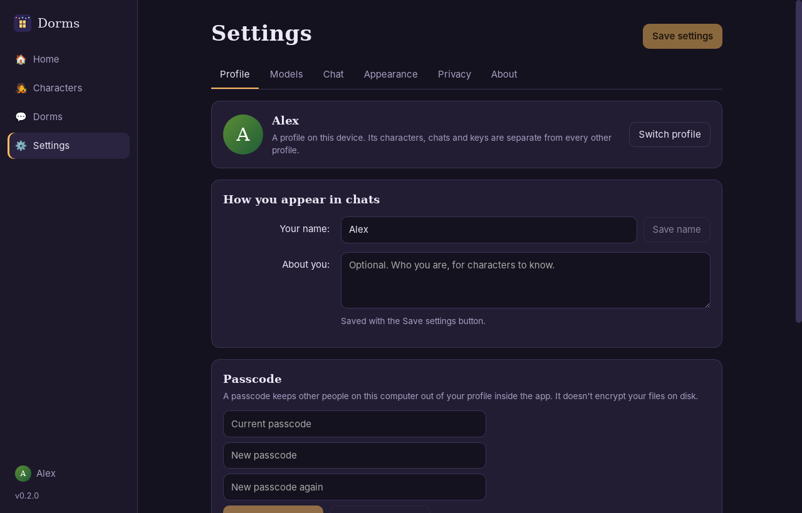<br>**Profile settings**: passcode, backup, **Eject**, delete |

**Phone layout** (the Android app uses this same interface; shown here at phone width)

<p>
  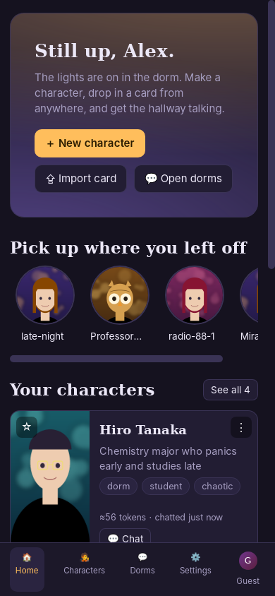
  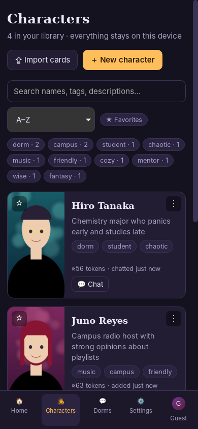
  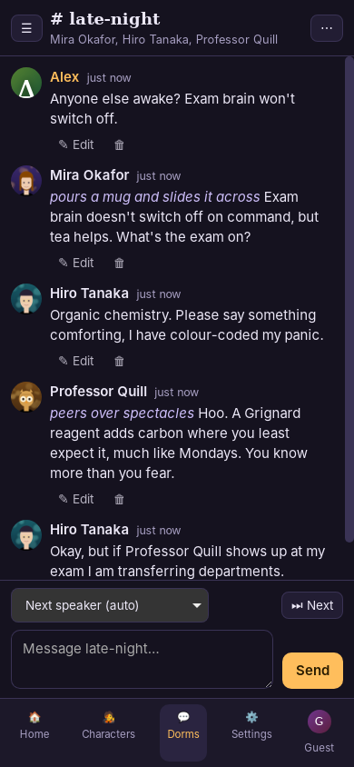
  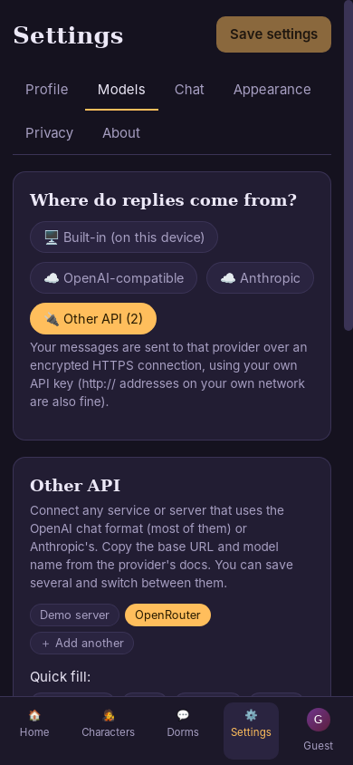
  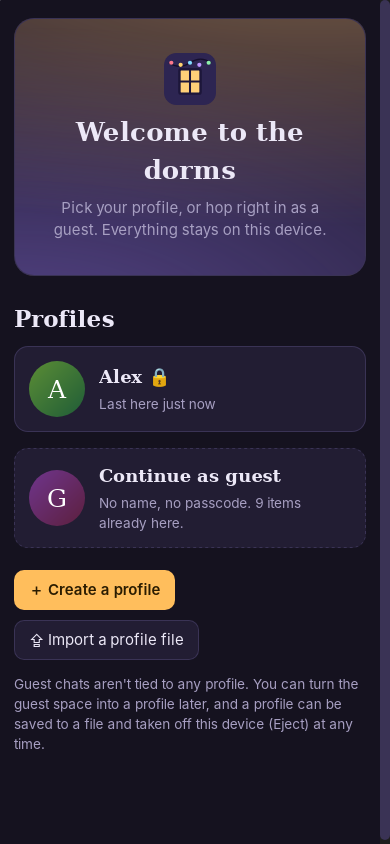
  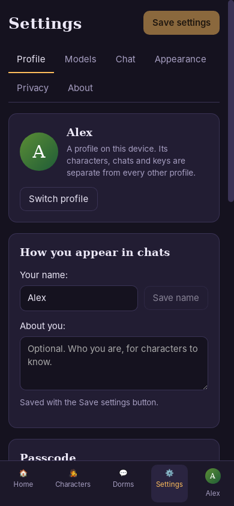
</p>

> Regenerate them any time with `tests/e2e/screenshots.py` (see the script's header).

## Features

- **Characters** with JPG / PNG / WebP / GIF / MP4 / WebM avatars and **VRM / VRoid 3D models** (VRM 0.x and 1.0)
- **A real 3D viewer**: the character stands in a furnished dorm room (night window, rug, bed, desk, string lights) with soft shadows.
  Drag to turn, scroll or pinch to zoom, double-click to reset, and open the **big viewer** for the whole room.
  The big viewer is a real window: drag its title bar to move it, pull any edge or corner to resize it (it remembers its size), or use **theatre mode** (T) or **full screen** (F). Esc steps back one level.
  She breathes, blinks, sways and follows you with her eyes. **Soft-body physics** run from the model's own spring bones
  (hair, skirt, sleeves, ears, chest): Natural / Bouncy / Off, plus a hop button to see them move.
- **She has a life of her own** (no AI needed): when you aren't talking to her she wanders the room, scrolls her phone (and sometimes
  gets annoyed, amused or upset at something she reads), drinks coffee at her desk, sits on the bed and goes to sleep, with the time of
  day nudging what she does. The moment you start typing she stops and pays attention. Turn it off with the 🎭 button.
- **Wardrobe** (👕 button in the 3D viewer): add extra outfits for a 3D character, which are other `.vrm` files of the same character in
  different clothes, and switch between them (rename and remove too). They are saved with the character and travel in backups.
  Accessories switch on and off: **cat, dog, fox, raccoon, bunny and wolf ears and their tails**, plus glasses, hats, hair accessories,
  bags and shoes, each remembered per model. Outfits change by swapping model files; individual garments are not switched off one by one.
- **Pause / Play** (or the Space bar) freezes her in place like a video: pose, walking, breathing, blinking and physics all stop,
  while you can still orbit the camera around her.
- **Talk to her inside the scene**: the big viewer has a see-through message bar along the bottom (type, or tap the mic), and her reply
  appears in a **manga-style speech balloon above her head** as it is written, a page at a time for long replies (click to move on).
- **Voice input**: the 🎤 button in a chat listens, turns your speech into text, and sends it, so the character can hear you and answer.
  It works with any speech-to-text server that offers `/v1/audio/transcriptions`: OpenAI or Groq (cloud), or a **local Whisper server**
  such as whisper.cpp's `whisper-server` for fully offline voice. Nothing is recorded unless you press the mic; the recording goes only to the
  server you choose in Settings → Voice (https required unless it's on your own network). Voice works best with a fast cloud API or a local
  model that fits your hardware. Microphone access depends on the system: the app opts in on Linux, Windows asks you, and Android asks for the permission.
- **Virtual hands** for the 3D viewer, with three gestures (🖐 open, 👆 point, 🤏 pinch; switch with the buttons, **P** and **G**, or your controller):
  - **Pet** (open hands): stroke her head or ears and she leans into your hand, half-closes her eyes and smiles; your controller rumbles gently.
  - **Poke** (pointing finger): click a spot and she reacts to *where* you poked: a giggle for a cheek, a flick of annoyance for the forehead,
    a boop on the nose, a squeal for an ear, a startled look over her shoulder from behind, a playful poke back at her hand. Poke her again and again
    and she gets annoyed. (Only ordinary places react: face, ears, shoulders, arms, hands and back.)
  - **Tickle**: press and hold with the pointing finger and the fingers wiggle. The laugh builds the longer you go (ears, arms, shoulders, back and hands are
    ticklish), and if you catch her in the middle of a big stretch she is caught off guard and bursts out laughing.
  - **Pick up** (pinch): pinch her by the scruff and lift her into the air. She dangles from your fingertips and swings like a pendulum as you move
    your hand, and she either panics (kicking, flailing, yelling) or hangs limp and sulks. Carry her somewhere else in the room (scroll to push her
    in or out), then let go: she drops, squashes on the floor, sees stars, and carries on from wherever you put her. Silly on purpose.
  - **Controllers**: Xbox, PlayStation (DualShock 4, DualSense), Nintendo (Switch Pro, Joy-Con), Steam Controller and Steam Deck (through Steam Input)
    and most other pads work. Sticks move the hands, triggers reach in, bumpers pull back; D-pad left / up / right pick open hands / point / pinch,
    the top button cycles, the bottom button (A, Cross, B) and left button act with the right and left hand (tap to poke, hold to tickle or pinch). Hints show
    your pad's own button names, and Settings → Controller lets you rebind every one.
- **Rooms**: make a place (a living room, a rooftop, a character's bedroom) with a name, a description and a backdrop (your own
  image or a built-in scene), set a dorm in it, and the characters know where they are while the chat shows the room behind it.
  Make the room first and the dorm after ("Create & enter"), or add a room to a dorm you already have.
- **Your own 3D rooms**: in a room's settings, import a house or room model (`.glb`, `.gltf` or `.fbx`, or a Unity package, `.unitypackage`, for example one from Booth). It replaces the built-in 3D room in chats set in that room.
  The app finds the floor, centres the model and works out where she can walk: she wanders, uses her phone and stretches there, and steps around the furniture (a bed, desk or window are only in the built-in room). Set the size, turn and height if it doesn't sit right.
  Each model has a sharing mark, **Not allowed to share** (the default) or **May be shared**. Only a model you mark as shareable goes into an exported profile file; the room itself is always exported, and the export tells you which models it left out. The mark is your own declaration, the app can't check a seller's licence. A Unity package is opened inside the app: the room model is taken out, the pictures its materials use are put back on, and it is saved as one `.glb`. If the package has several models you choose which one is the room. A package over 4 GB, with not enough free space on the device, with a room over about 1 GB, or with no single room model in it (only separate props in a Unity scene, or only formats like `.blend`) is refused with the reason. Unity shaders and baked lighting are not carried over, so rooms look flatter than in VRChat.
- **Decorations**: a library of 3D props (furniture, plants, food…) for decorating rooms. Import a Unity package full of props and tick which models to keep, or add a single `.glb` or `.fbx`. Each decoration has a sharing mark, **Not allowed to share** (the default) or **May be shared**: only decorations marked shareable go into an exported profile (the export tells you which it left out, and ejecting removes the others from the device). Placing decorations in a room comes in the next version.
- **Text size**: a slider in the chat itself (next to the other chat options) and in Settings → Appearance makes the roleplay text bigger or smaller, from 80% to 200%, with a sample. It is kept on the device.
- **Prompts**: saved pieces of text for roleplay (a mid-chat instruction, a style reminder…). **Prompts** in the side bar opens as a drop-down, so the chat you are in stays open. Press and hold a prompt and drag it into the chat to send it as your message at once; if you have already typed something, the prompt is added to your message box instead, so you can add to it and send it yourself. Click a prompt to put it in the message box (this is also how it works on a phone, where dragging isn't available). Add, edit, copy and delete prompts from the same drop-down; they are per profile and are in backups.
- **Background music**: pick an MP3 (or another audio file) from your computer for a room or a dorm. It plays quietly on a loop while you
  are in a chat there, with pause, mute and volume. A dorm's own music is used instead of its room's.
- **Mechanics** (🧩 in a chat): optional story layers you switch on or off per chat. Import a `.bundle.json` pack (an affection and trust
  tracker, a relationships panel, a status panel, a phone…): its notes join the prompt, its numbers move with keywords and with what the
  character writes (hidden `[affection: add 3]` lines are removed before you read the reply), and you can watch or adjust them.
  Nothing is forced on a chat. A pack's own custom screens are not run; the app shows its values in built-in panels instead.
- **Phone mode** (📱 in a chat): the same conversation as a texting experience: a phone with message bubbles, and replies written and
  shown as short texts.
- **Character folders**: optional folders in the library, and folders can nest, so you can keep a "Canon character RP" folder with a folder per series inside it,
  and each series' characters inside that. Drag characters or folders onto a folder (or onto the path at the top), or use ⋮ → Move to folder / Move folder…; rename a folder,
  give it its own picture, or let it borrow the picture of one of the characters inside it (**Use a character's picture**). Deleting a folder never deletes anything: its characters and subfolders move up one level.
  **My order** (the default sort) lets you drag a character's card to wherever you want it, in the top level and inside any folder; the left or right half of a card decides whether it lands before or after it. On a touch screen use ⋮ → Move earlier / Move later.
- **Position your pictures**: choosing an avatar opens a window where you drag and zoom until the face is just right (with previews of the
  card, round avatar and banner). The framing is saved, can be changed later (⤧ Position), and is used everywhere the picture appears.
  Library cards are bigger too.
- **Lorebooks**: a Lorebooks library (import SillyTavern world info or a card's book), attached to any number of characters, working
  together with the book inside a card. **More initial messages** sit in the main editor, and you pick which one opens a new chat.
- **Notes**: a page for writing with no length limit, like a card's creator notes but always a click away. Saves by itself; search and pin.
- **Chub-style character editor**: tagline, in-chat name, tags, description, first message, scenario, example dialogs,
  live token counts, alternate greetings (as swipes), system prompt, post-history instructions, character's note with depth,
  and an embedded lorebook (keyword / regex triggers). Everything stays editable after creation.
- **Character card import and export** (V1, V2 and V3; JSON and PNG). Import is deliberately forgiving: wrong types and missing
  fields never cause an error, unknown fields are kept and written back, so round trips lose nothing. Tested against cards written by
  independent tools (tEXt, zTXt and ccv3 chunks, non-Latin text, loose JSON, SillyTavern-style lorebooks).
- **Chats**: one-on-one, group chats, and channels inside dorms. Swipe, regenerate, **continue** (ask the character to keep going and extend the same message), edit and delete messages.
  Turn order: take turns, random, or reply when named.
- **Bots talking to each other**: optional per channel, off by default, with a pace and an automatic stop after N bot-only turns
  so an unattended channel can't drain your battery or API credit.
- **Built-in local models** with a hardware-aware downloader (resumable), or bring any GGUF. GPU acceleration through Vulkan,
  falling back to CPU automatically.
- **Cloud and other APIs**: OpenAI-compatible, Anthropic, or **Other API**: save any number of custom endpoints
  (OpenAI-style or Anthropic-style) with your own base URL, model, auth style, extra headers and extra JSON body.
  Works with OpenRouter, Groq, Together, Mistral, DeepSeek, xAI, Ollama, LM Studio, and anything new that speaks one of those formats.
- **Local profiles, guest mode and Eject**: keep several people's (or personas') characters, chats, settings and API keys apart on one device, each with an optional passcode, or just hop in as a guest with nothing tied to a name. **Eject** saves a profile to a verified file and takes it off the device (not a delete: import the file here or on another device to bring it all back). A guest space can be turned into a profile later. Everything is local; there is no online account.
- **Privacy**: no online accounts, no analytics. Remote traffic is HTTPS (TLS via rustls) from the Rust backend, so keys never touch the web view.
  Keys go in your OS keychain, or a private file if none exists. See *Settings → Privacy*.
- **Hostile cards are contained**: an imported card's own system prompt is demoted to lower-priority notes until you trust it, and the web view can't read your database or keys. See [SECURITY.md](SECURITY.md).

## Install

Grab a file from the [Releases](https://github.com/theStyleWithin/Desktop-college-dorms/releases) page.

| Platform | File | Notes |
|---|---|---|
| Linux (any distro, SteamOS, CachyOS, …) | `DesktopCollegeDorms_*_amd64.AppImage` | `chmod +x` and run. Bundles WebKit and the media framework |
| Debian / Ubuntu | `.deb` | |
| Fedora / openSUSE | `.rpm` | |
| Arch / CachyOS | AUR package files in [`packaging/aur`](packaging/aur) | hand-off, see below |
| Flatpak | manifest in [`packaging/flatpak`](packaging/flatpak) | hand-off, see below |
| Windows | `*_x64-setup.exe` | per-user installer, no admin needed |
| Windows (no install) | `*_x64_portable.exe` | one file; engine inside; data in a `DormsData` folder beside it |
| Android | `*_android.apk` | cloud / network models only (see limitations) |

**Steam Deck**: use the AppImage in Desktop Mode. The Vulkan engine uses the Deck's GPU.

First run: open **Settings → Models** and download a model (the app suggests one that fits your memory), or pick a cloud provider.
Then create or import a character and start a chat.

## Limitations (please read)

- **Android has no built-in engine yet.** Android doesn't allow launching the helper program the desktop builds use. Use a cloud provider,
  or point *Other API* at a model server on your home network (Ollama, LM Studio, or this app on your PC).
- **Passcodes are a lock, not encryption.** A profile passcode keeps other people on the same computer out of your profile inside the app. It does not encrypt files on disk, and Eject/backup files are not encrypted either (they never contain API keys or passcodes). See [SECURITY.md](SECURITY.md).
- The built-in engine needs an **AVX2 CPU** (Intel Haswell / AMD Zen or newer, which includes the Steam Deck).
- Windows portable build needs the **WebView2 runtime** (already present on Windows 11 and nearly all updated Windows 10).
- Video avatars load into memory when played (library thumbnails play on hover), so keep them reasonably small.
- Battery-aware pausing isn't implemented; the per-channel pace and turn limit are the power controls.
- **Verification status**: the Linux AppImage, the portable (single-file) build and the whole app are covered by an automated end-to-end suite
  that drives the real packaged app (card import/export, editing, GIF/video/VRM, real model chat, channels with bots, downloads, cloud and
  Other API paths, local profiles with passcodes and lockout, profile isolation, and the export / eject / import round trip, and the live 3D viewer). The **Windows installer/portable and the Android APK are built by CI but have not been run on a real device by the author**.
  If your graphics drivers can't run WebGL, the app notices an unfinished 3D attempt on the next launch and
  shows a placeholder with a "Try again" button instead of repeating a crash.
  The Flatpak and AUR files are untested hand-offs.

## Build from source

Requirements: Rust (stable), Node 20+, CMake, a C++ toolchain, and on Linux the Tauri prerequisites
(`libwebkit2gtk-4.1-dev libgtk-3-dev libsoup-3.0-dev libdbus-1-dev …`, see the CI workflow for the full list).
For GPU acceleration also the Vulkan SDK / `shaderc` (otherwise the CPU engine alone is built).

```bash
npm ci
node scripts/build-llama.mjs      # builds the bundled engine(s); SKIP_VULKAN=1 for CPU only
npx tauri dev                     # run in development
npx tauri build                   # installers for your OS
cargo test --workspace            # unit tests
```

End-to-end tests (Linux; needs `xvfb`, `webkit2gtk-driver`, `tauri-driver`, `ffmpeg`, `pip install selenium pillow`):

```bash
tests/e2e/fetch_assets.sh ./e2e-assets
E2E_BUNDLED_ENGINE=1 xvfb-run -a python3 tests/e2e/e2e.py <app or AppImage> e2e-assets/fixtures e2e-assets/model.gguf ./e2e-work
# without E2E_BUNDLED_ENGINE the suite uses src-tauri/binaries/dorms-engine-* (a dev build)
```

## Project layout

```
crates/dorms-core   card parsing/export (V1/V2/V3, JSON+PNG) and prompt assembly; no UI dependencies; unit tested
src-tauri           Tauri backend: SQLite storage, engine management, model downloads, streaming API clients, secrets
src                 React + TypeScript frontend (three.js + three-vrm for 3D)
scripts             build-llama.mjs (bundled engine), package-linux-tarball.sh
packaging           Flatpak manifest and AUR PKGBUILDs (hand-off), desktop/metainfo files
tests/e2e           end-to-end suite driving the real app through WebDriver
.github/workflows   CI that builds every package and runs the suite against the AppImage
```

Your data (database, images, models) is in the app data folder (Settings → About shows the path), or beside the executable
for the portable build. Copy that folder to back up or move everything.

## Packaging hand-off

The Flatpak manifest and AUR packages are ready for someone else to submit; the project owner **has given full consent** for
anyone to package and publish this MIT-licensed app, no need to ask. Details in [`packaging/README.md`](packaging/README.md).

## License

MIT, see [LICENSE](LICENSE). The bundled engine is [llama.cpp](https://github.com/ggml-org/llama.cpp) (MIT).
See [SPEC.md](SPEC.md) for the original design notes.
